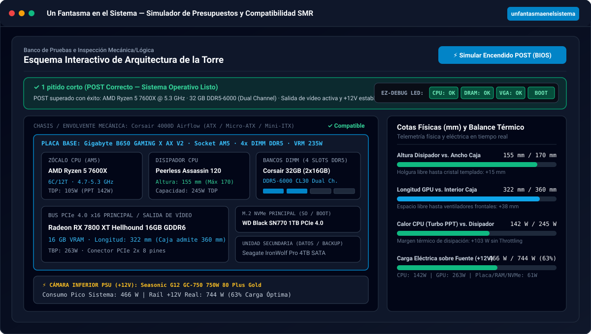
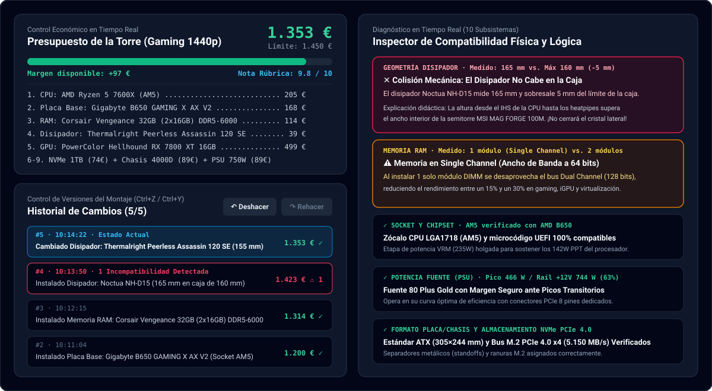
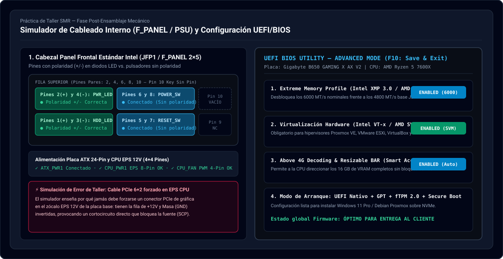
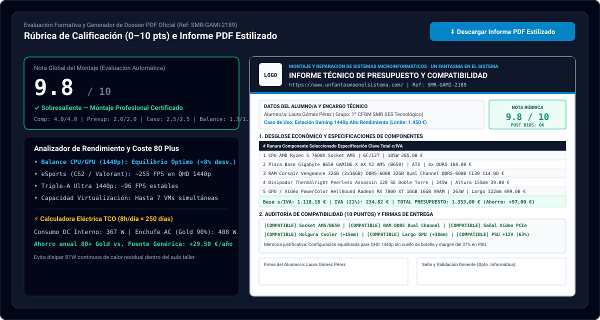

<div align="center">
  <a href="https://www.unfantasmaenelsistema.com/" target="_blank" rel="noopener noreferrer">
    
  </a>

  # Simulador de Presupuestos y Compatibilidad de Hardware (SMR / ASIR)

  **Recurso educativo interactivo para el módulo de Montaje y Reparación de Sistemas Microinformáticos**

  [](https://www.unfantasmaenelsistema.com/)
  [](https://react.dev/)
  [](https://www.typescriptlang.org/)
  [](https://vitejs.dev/)
  [](https://pages.github.com/)
</div>

---

## 🎯 ¿Qué hace esta aplicación?

Una **Single Page Application (SPA)** 100% estática y desplegable en **GitHub Pages** donde el alumnado de Formación Profesional (**CFGM Sistemas Microinformáticos y Redes — SMR** y **CFGS ASIR**) debe diseñar, ensamblar, cablear y presupuestar una torre completa cumpliendo un **presupuesto límite fijado** y los requisitos técnicos de un **caso de uso real**:

1. **Ofimática, ERP y Gestión Administrativa (520 €)**: Bajo consumo ($\le 250\text{ W}$), gráficos integrados (APU/iGPU), mínimo 16 GB RAM y SSD NVMe.
2. **Estación Gaming 1440p Alto Rendimiento (1.450 €)**: GPU dedicada con $\ge 12\text{ GB}$ VRAM, CPU de alto IPC, 32 GB RAM en *Dual Channel*, SSD NVMe $\ge 1\text{ TB}$ y fuente 80 Plus con margen $\ge 25\%$.
3. **Servidor de Virtualización y Contenedores Proxmox / ESXi (1.950 €)**: CPU multinúcleo ($\ge 12$ núcleos / 24 hilos), $\ge 64\text{ GB}$ RAM, unidad NVMe principal para hipervisor + disco secundario para copias de seguridad.
4. **Estación de Edición de Vídeo 4K y Renderizado 3D (1.750 €)**: Equilibrio CPU multinúcleo + GPU dedicada de $\ge 12\text{ GB}$ VRAM, refrigeración de alto TDP y almacenamiento NVMe PCIe 4.0 con caché DRAM.
5. **Laboratorio de Prácticas Libre (400 € – 3.000 €)** + **3 Retos de Diagnóstico de Averías («Caza-Errores»)**: Presupuestos defectuosos de taller para que el alumno identifique y corrija colisiones mecánicas, fallos de socket/RAM o ausencias de señal de vídeo.

---

## 📸 Capturas de Pantalla de la Aplicación

### 1. Esquema Interactivo de Arquitectura, Cotas en Milímetros y Test POST (BIOS)
Comprueba visualmente las ranuras de la placa base, los bancos DIMM ocupados, las holguras físicas en milímetros y simula el encendido **POST (Power-On Self-Test)** con los 4 LEDs de diagnóstico **EZ-Debug (`CPU`, `DRAM`, `VGA`, `BOOT`)** y códigos de pitidos AMI BIOS:



---

### 2. Inspector de Compatibilidad en Tiempo Real e Historial de Cambios (`Undo / Redo`)
Audita en vivo 10 puntos críticos de compatibilidad física, térmica, eléctrica y lógica, e incluye un sistema completo de **Historial de Cambios (`Ctrl+Z` / `Ctrl+Y`)** con línea de tiempo interactiva y botón de recuperación rápida al último estado sin errores:



---

### 3. Laboratorio de Cableado Interno (`F_PANEL` 9 Pines / PSU) y Setup UEFI/BIOS
Permite practicar la conexión eléctrica de la placa (**ATX 24 pines**, **CPU EPS 12V 8 pines vs. trampa de cortocircuito con PCIe 6+2 pines**, **cabezal PWM `CPU_FAN`**) y el pinout del panel frontal **`JFP1 / F_PANEL`** (diferenciando diodos LED con polaridad `+/-` frente a pulsadores `POWER_SW` y `RESET_SW`), además de configurar la **BIOS/UEFI** (`XMP/EXPO`, `VT-x / AMD-V`, `Resizable BAR`, `UEFI GPT + fTPM 2.0`):



---

### 4. Evaluación por Rúbrica (0–10 puntos), Calculadora 80 Plus e Informe PDF Oficial
Califica automáticamente el montaje sobre 10 puntos, calcula cuellos de botella por resolución (`1080p`, `1440p`, `4K`), estima el ahorro energético anual de una fuente **80 Plus Gold** y genera un **Dossier PDF Estilizado (`jsPDF`)** listo para entregar al profesor:



---

## 🔍 Mecánica Didáctica: Matriz de 10 Validaciones en Tiempo Real

| # | Subsistema Evaluado | Qué comprueba en tiempo real | Explicación didáctica en el simulador |
| :-: | :--- | :--- | :--- |
| **1** | **Socket y Chipset** | `AM4` (PGA 1331) vs `AM5` (LGA 1718) vs `LGA1700` | Impide combinar procesadores y placas base de distinto zócalo físico o generación incompatible. |
| **2** | **Etapa de Potencia VRM** | Consumo Turbo CPU (`MTP/PPT`) vs. `Máx W VRM` de la placa | Advierte de *VRM Thermal Throttling* si se monta un procesador de >180W–253W en una placa básica sin disipación VRM. |
| **3** | **Memoria RAM y Canales** | `DDR4` vs `DDR5`, nº de módulos vs slots DIMM (2 vs 4) y *Dual Channel* | Detecta incompatibilidad física de muesca DDR4/DDR5, exceso de módulos y penalización de ancho de banda por usar 1 solo módulo (*Single Channel* 64 bits). |
| **4** | **Señal de Vídeo (POST VGA)** | Procesadores sin iGPU (Intel `F`/`KF`, Ryzen sin `G`) sin GPU dedicada | Simula el bloqueo en el LED `VGA` de la placa base (1 pitido largo y 3 cortos) cuando los puertos HDMI/DP de la placa están inactivos. |
| **5** | **Geometría del Disipador** | Altura del cooler (`mm`) y radiador AIO 240mm vs. ancho interior del chasis | Calcula la holgura exacta en milímetros hasta el panel lateral de cristal templado o detecta colisión mecánica. |
| **6** | **Balance Térmico (TDP)** | `TDP Base` y `Turbo MTP/PPT` de CPU vs. `Máx TDP` del disipador | Detecta si un disipador stock (65W) es incapaz de evacuar el calor de una CPU de alto consumo bajo estrés continuo. |
| **7** | **Geometría de GPU** | Longitud de la tarjeta gráfica (`mm`) vs. largo máximo admitido por el chasis | Evita que tarjetas gráficas de triple ventilador (305–357 mm) choquen contra el frontal de cajas compactas. |
| **8** | **Factor de Forma Mecánico** | Placa base (`ATX`, `Micro-ATX`, `Mini-ITX`) vs. bandeja de la caja | Verifica que los postes separadores (*standoffs*) y dimensiones del PCB (305×244 mm en ATX) quepan en el chasis. |
| **9** | **Fuente de Alimentación (PSU)** | Consumo pico del sistema vs. vatios reales en el raíl `+12V` y cables PCIe | Comprueba conectores PCIe de 8 pines / ATX 3.0 `12VHPWR` y recomienda un margen de seguridad del 25–30%. |
| **10** | **Almacenamiento y Buses** | Nº de zócalos `M.2 NVMe`, bahías `3.5"` y generación `PCIe 3.0 / 4.0 / 5.0` | Advierte si se usa un HDD mecánico como disco de arranque o si un NVMe PCIe 4.0/5.0 queda limitado por un bus PCIe 3.0. |

---

## 🛠️ Instalación y Ejecución en Local

Requisitos previos: **Node.js 20+** y **npm**.

```bash
# 1. Clonar el repositorio
git clone https://github.com/TU_USUARIO/simulador-presupuestos-hardware-smr.git
cd simulador-presupuestos-hardware-smr

# 2. Instalar dependencias
npm install

# 3. Iniciar servidor de desarrollo (http://localhost:3000)
npm run dev

# 4. Compilar versión de producción estática (carpeta dist/)
npm run build
```

---

## 🚀 Cómo Subir a GitHub y Publicar en GitHub Pages

El proyecto ya incluye `base: './'` en `vite.config.ts` (para que todas las rutas y el logotipo funcionen en cualquier subcarpeta de GitHub Pages) y el flujo de trabajo automático en **`.github/workflows/deploy.yml`**.

1. **Sube el código a un repositorio de GitHub**:
   ```bash
   git init
   git add .
   git commit -m "feat: simulador de presupuestos y compatibilidad de hardware SMR"
   git branch -M main
   git remote add origin https://github.com/TU_USUARIO/NOMBRE_DEL_REPO.git
   git push -u origin main
   ```
2. **Activa GitHub Pages en tu repositorio**:
   - Entra en tu repositorio en GitHub y ve a **Settings** $\rightarrow$ **Pages**.
   - En **Build and deployment** $\rightarrow$ **Source**, selecciona **`GitHub Actions`**.
   - El workflow `Desplegar en GitHub Pages` se ejecutará automáticamente y publicará la aplicación en `https://TU_USUARIO.github.io/NOMBRE_DEL_REPO/`.

---

## 📁 Estructura del Proyecto

```text
├── .github/workflows/
│   └── deploy.yml                             # Despliegue automático en GitHub Pages
├── public/
│   ├── assets/aistudio/icono_81a3db5b.png     # Logotipo oficial sin distorsión
│   └── docs/screenshots/                      # Capturas vectoriales para el README
├── src/
│   ├── components/
│   │   ├── BuildHistoryPanel.tsx              # Historial de cambios (Undo/Redo + Línea de tiempo)
│   │   ├── ComponentCatalogSelector.tsx       # Catálogo filtrado + Modo Examen sin pistas
│   │   ├── InteractiveArchitectureDiagram.tsx # Plano técnico interactivo + Test de arranque POST
│   │   ├── InteractiveQuizAndGenerator.tsx    # Test oficial SMR + Generador de encargos
│   │   ├── PerformanceAndEnergyAnalyzer.tsx   # Cuello de botella, FPS, VMs y Calculadora 80 Plus
│   │   ├── RubricAndBudgetReport.tsx          # Rúbrica (0-10), Vista previa A4 y exportación
│   │   ├── WiringAndBiosLab.tsx               # Laboratorio de cableado F_PANEL y Setup UEFI/BIOS
│   │   └── WorkshopReferenceGuide.tsx         # Manual rápido de taller SMR
│   ├── data/
│   │   └── hardwareCatalog.ts                 # Catálogo real de CPUs, Placas, RAM, GPUs, PSUs y Retos
│   ├── types/
│   │   └── hardware.ts                        # Tipado estricto en TypeScript
│   ├── utils/
│   │   ├── compatibilityEngine.ts             # Motor de las 10 validaciones y cálculo de rúbrica
│   │   └── pdfReportGenerator.ts              # Generador de informes PDF estilizados (jsPDF)
│   ├── App.tsx                                # Aplicación principal y gestión de estado/URL
│   └── main.tsx                               # Punto de entrada React
├── index.html
├── package.json
└── vite.config.ts                             # Configurado con base: './' para GitHub Pages
```

---

## 🌐 Autoría y Enlaces

Desarrollado para el aula taller de **Montaje y Reparación de Sistemas Microinformáticos**.
- **Web oficial**: [https://www.unfantasmaenelsistema.com/](https://www.unfantasmaenelsistema.com/)
