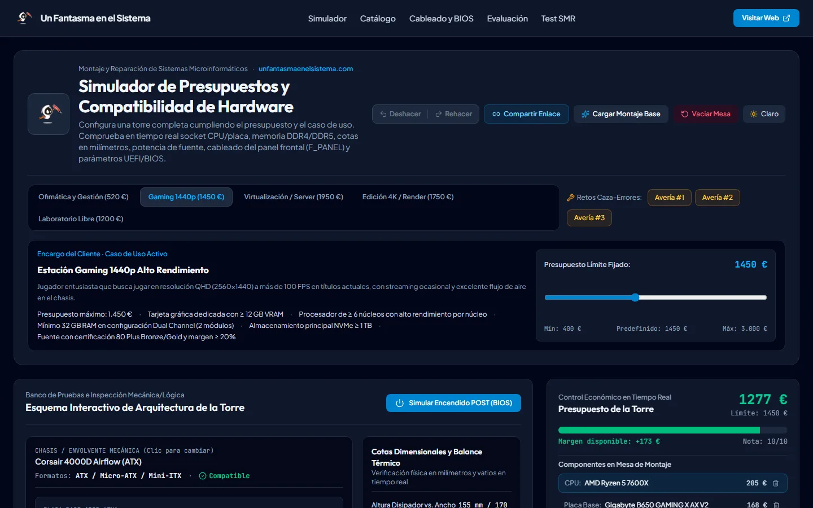
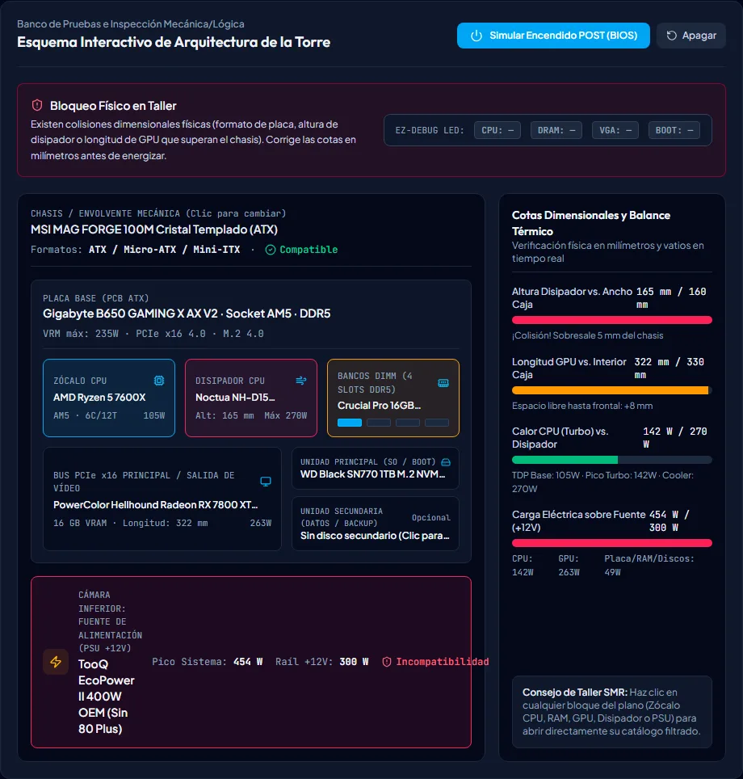
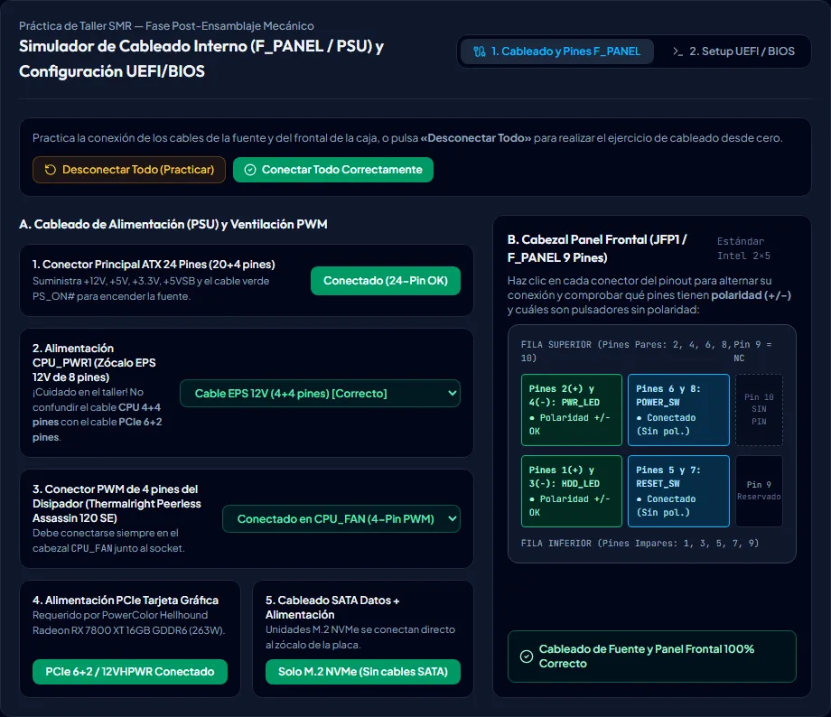
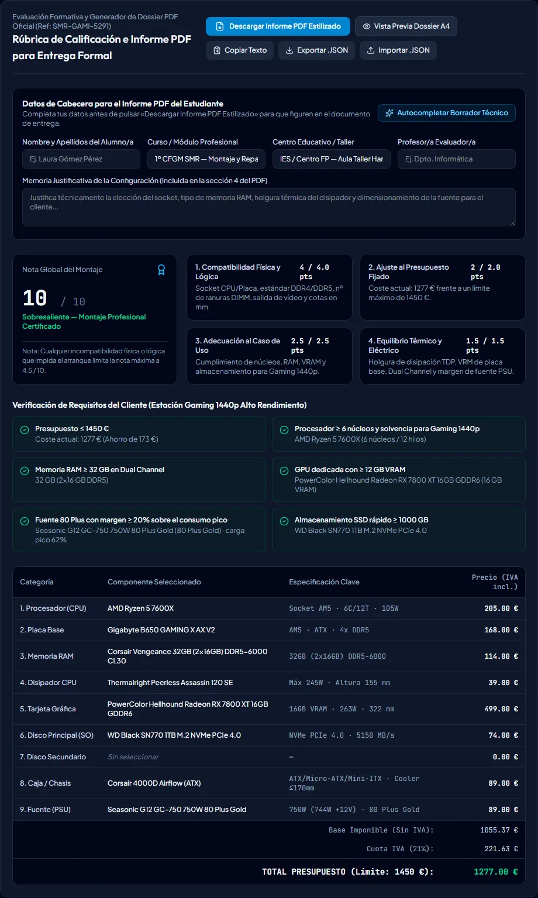

<p align="center">
  <a href="https://www.unfantasmaenelsistema.com"></a>
</p>

<h1 align="center">Simulador de Presupuestos y Compatibilidad de Hardware</h1>

<p align="center">
  <b>Monta, presupuesta y diagnostica una torre completa para el módulo de Montaje y Reparación (SMR / ASIR)</b><br>
  Socket y chipset · DDR4/DDR5 y ranuras DIMM · Cotas en mm · TDP y VRM · Fuente +12V · Buses PCIe/M.2 · POST · Cableado F_PANEL · UEFI · Rúbrica e informe PDF
</p>

<p align="center">
  <a href="https://unfantasmaenelsistema.github.io/SimuladorPresupuestosHardware/"><b>▶ Abrir el simulador</b></a> ·
  <a href="#qué-hace">Qué hace</a> ·
  <a href="#para-clase">Para clase</a> ·
  <a href="#cómo-evalúa">Cómo evalúa</a> ·
  <a href="#desarrollo">Desarrollo</a> ·
  <a href="https://www.unfantasmaenelsistema.com">unfantasmaenelsistema.com</a> ·
  <a href="LICENSE">MIT</a>
</p>

<p align="center">
  
  
  
  
</p>

<p align="center">
  
</p>

El alumnado elige un encargo de cliente (ofimática, gaming, virtualización, edición 4K o laboratorio libre), monta las nueve piezas de la torre y ve en tiempo real si encajan, si arrancan y si caben en el presupuesto. Después cablea la fuente y el panel frontal, ajusta la UEFI, simula el POST y descarga un informe en PDF con la nota de la rúbrica para entregarlo.

> [!NOTE]
> Es un modelo didáctico. Los sockets, estándares de memoria, cotas, TDP, consumos y conectores del catálogo son los de los productos reales; los precios son orientativos y las cifras de FPS, VMs y coste eléctrico son estimaciones para comparar configuraciones en clase.

## Qué hace

- **Cinco encargos de cliente** con presupuesto y requisitos propios: Ofimática y ERP (520 €), Gaming 1440p (1.450 €), Servidor de virtualización Proxmox/ESXi (1.950 €), Edición 4K y render (1.750 €) y Laboratorio libre (400–3.000 €). Cada uno tiene su montaje base de referencia, sin errores ni avisos.
- **Catálogo real** de 13 CPU (AM4, AM5, LGA1700), 10 placas, 10 kits de RAM, 8 disipadores, 9 opciones gráficas, 9 unidades, 7 cajas y 7 fuentes, con filtro de compatibles y **modo examen** que oculta las pistas.
- **Inspector de 10 comprobaciones** que explica cada fallo con su medida y su límite: socket, VRM, RAM (estándar, ranuras, Single Channel, 4 módulos DDR5), vídeo (CPU «F» sin gráfica), altura del disipador, TDP, longitud de la GPU, formato placa/caja, fuente (+12V y cables PCIe) y almacenamiento (ranuras M.2, bahías y generación PCIe real del M.2).
- **Esquema interactivo de la torre** con holguras en milímetros, balance térmico y eléctrico y **simulación del POST** con los LED EZ-Debug (CPU, DRAM, VGA, BOOT) y los códigos de pitidos AMI.
- **Tres retos Caza-Errores**: presupuestos de taller defectuosos que el alumno tiene que corregir.
- **Laboratorio de cableado y UEFI**: ATX 24 pines, EPS 12V frente al «cortocircuito» del PCIe 6+2, cabezal CPU_FAN, alimentación de la GPU, SATA y el pinout JFP1/F_PANEL con polaridad de los LED; en la UEFI, XMP/EXPO (con kits JEDEC nativos), VT-x/AMD-V, Resizable BAR y UEFI+fTPM frente a CSM.
- **Rendimiento y energía**: cuello de botella CPU/GPU por resolución, capacidad de virtualización y calculadora de ahorro de una fuente 80 Plus.
- **Rúbrica sobre 10**, vista previa A4, **informe PDF**, copia en texto, exportación/importación **JSON** y **enlace para compartir** el montaje.
- **Historial con deshacer/rehacer** (Ctrl+Z / Ctrl+Y) y vuelta al último estado sin errores.
- **Test de 8 preguntas** con opciones barajadas y generador de encargos aleatorios.

<p align="center">
  
</p>

## Para clase

1. **Encargo**: elige el caso de uso y, si quieres, ajusta el presupuesto. El panel del cliente lista los requisitos que se van a evaluar.
2. **Montaje**: el alumno instala pieza a pieza desde el catálogo (o desde el esquema). Con el **modo examen** no ve qué piezas son incompatibles hasta que las monta.
3. **Diagnóstico**: el inspector y el botón **Simular Encendido POST** dicen si la torre arranca y dónde se para.
4. **Cableado y UEFI**: «Desconectar Todo» deja la torre sin cables para practicar el conexionado; los errores de cableado también paran el POST.
5. **Entrega**: el alumno rellena sus datos y la memoria justificativa y descarga el **PDF**, o exporta el **JSON** para que el profesor lo importe y lo revise.

Los **retos Caza-Errores** cargan un montaje roto con el síntoma del taller:

| Reto | Síntoma | Qué hay que encontrar |
| :-- | :-- | :-- |
| Avería 1 | PC de oficina sin vídeo y con la RAM que no entra | CPU LGA1700 en placa AM4, i3-12100F sin iGPU ni gráfica, DDR5 en placa DDR4 y placa ATX en caja Micro-ATX |
| Avería 2 | La tapa no cierra y el PC se apaga al jugar | Disipador de 165 mm en caja de 160 mm, fuente sin cables PCIe e insuficiente, RAM en Single Channel |
| Avería 3 | Sobran módulos y la CPU hierve | Kit de 4 módulos en placa de 2 ranuras y disipador de serie en un Ryzen 9 de 170 W TDP |

<p align="center">
  
</p>

## Cómo evalúa

- **Consumo pico** = Turbo de la CPU (PL2/PPT) + TBP de la GPU + 38 W de placa y ventiladores + 5 W por módulo de RAM + discos. Se compara con la potencia real del raíl de +12V de la fuente: por encima, error (OPP/OCP); por encima del 82 %, aviso de margen escaso. La recomendación es el pico × 1,3.
- **Generación PCIe del M.2**: manda la ranura M.2 de la placa y las líneas de la CPU. En LGA1700 las líneas PCIe 5.0 de la CPU van a la ranura gráfica, así que el M.2 trabaja a PCIe 4.0; un Ryzen 4600G o una A520 lo dejan en PCIe 3.0.
- **Rúbrica (10 puntos)**: compatibilidad 4 (−1,5 por error, −0,35 por aviso), presupuesto 2, adecuación al encargo 2,5 (proporción de requisitos cumplidos) y equilibrio térmico/eléctrico 1,5. Cualquier error que impida arrancar limita la nota a 4,5.

<p align="center">
  
</p>

## Privacidad

Todo se ejecuta en el navegador. No hay servidor, cuentas ni analítica: los datos del alumno solo salen del equipo si él descarga el PDF o el JSON. Las fuentes tipográficas van incluidas en la web y una política CSP estricta impide cargar código o estilos de terceros.

## Desarrollo

Requisitos: Node.js 20 o superior.

```bash
git clone https://github.com/unfantasmaenelsistema/SimuladorPresupuestosHardware.git
cd SimuladorPresupuestosHardware
npm ci
npm run dev      # http://localhost:3000
npm test         # pruebas del motor de compatibilidad (Vitest)
npm run lint     # comprobación de tipos
npm run build    # versión estática en dist/
```

El workflow `.github/workflows/deploy.yml` comprueba tipos, pasa las pruebas, compila y publica `dist/` en GitHub Pages en cada push a `main`. `vite.config.ts` usa `base: './'`, así que la misma build funciona en la project page y en cualquier subcarpeta.

```text
src/
├── data/hardwareCatalog.ts          # catálogo, encargos, montajes base y retos
├── utils/compatibilityEngine.ts     # las 10 comprobaciones, consumo y rúbrica
├── utils/compatibilityEngine.test.ts
├── utils/pdfReportGenerator.ts      # informe PDF (jsPDF + autotable)
├── utils/pdfText.ts                 # adapta el texto a la fuente del PDF
└── components/                      # esquema y POST, catálogo, cableado/UEFI, rendimiento, rúbrica, test y guía
```

## Cambios

### 2.0.0 (2026-10-31)

- Publicado en la organización con despliegue en GitHub Pages: el workflow original fallaba siempre (caché de npm sin `package-lock.json`).
- **Generación PCIe del M.2**: antes se usaba la de la ranura gráfica, así que un SSD PCIe 5.0 en una placa LGA1700 (M.2 a PCIe 4.0) no avisaba. Ahora cada placa tiene su versión M.2, se tiene en cuenta el límite de la CPU y también se revisa la unidad secundaria.
- **POST**: el fallo de vídeo usaba el código de Award; en AMI son 1 pitido largo y 8 cortos. Una fuente sin cables PCIe ya no se trata como un disparo de OPP, sino como gráfica sin alimentación (LED VGA). El disipador insuficiente se explica como estrangulamiento térmico.
- **RAM**: aviso de frecuencia reducida con 4 módulos DDR5 (2 por canal). Cada kit tiene su velocidad JEDEC, así que los módulos JEDEC nativos (Crucial Pro 5600, Kingston Server Premier) ya no avisan de que les falta XMP.
- **Gaming**: el requisito «fuente 80 Plus con margen ≥ 20 %» se anunciaba pero no se evaluaba.
- **Montaje base de Ofimática** con Ryzen 5 8500G: el anterior (4600G + A520) dejaba el NVMe a PCIe 3.0. El disipador de serie se modela para CPUs de 65 W TDP (hasta ~90 W de PPT).
- **Test**: las 8 respuestas correctas estaban siempre en la segunda opción y se podía cambiar la respuesta después de ver la solución. Ahora las opciones se barajan y la respuesta queda fijada. Los encargos aleatorios piden lo mismo que luego se evalúa.
- **PDF**: los símbolos ≤ y ≥ salían como basura con la fuente del PDF; las cabeceras recuperan las tildes.
- **Interfaz**: la barra de botones desbordaba a unos 1.000 px de ancho y la página entera en el móvil; corregido el rótulo del pin 9 del F_PANEL, la avería 1 menciona el cruce de socket y los consumos recomendados de algunas GPU son los del fabricante.
- **Privacidad y seguridad**: fuentes incluidas en la web en lugar de Google Fonts, CSP estricta, sin dependencias de Gemini ni Express que no se usaban, y 19 pruebas automáticas del motor.

### 1.0.0

- Versión inicial generada con Google AI Studio.

## Créditos y licencia

Creado por **[Un Fantasma en el Sistema](https://www.unfantasmaenelsistema.com)** para el aula taller de Montaje y Reparación de Sistemas Microinformáticos. Fuentes Outfit, Plus Jakarta Sans y JetBrains Mono (SIL Open Font License) vía Fontsource; iconos de Lucide (ISC).

Código bajo licencia [MIT](LICENSE).
